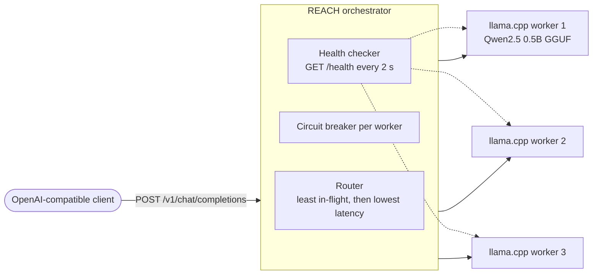

# REACH

[](https://github.com/pavanprudhvi02/reach/actions/workflows/ci.yml)

**R**esilient **E**dge **A**I **C**luster **H**ost: a Spring Boot orchestrator that serves LLM chat requests from a pool of CPU-only [llama.cpp](https://github.com/ggml-org/llama.cpp) workers. It sends each request to the least-loaded healthy worker, and when a worker crashes, stalls or starts failing, it moves the request to another worker and stops sending it traffic until it recovers. The API is OpenAI-compatible, so existing clients work unchanged.

**Stack:** Java 21, Spring Boot 3 (virtual threads), Resilience4j, Micrometer and Prometheus, llama.cpp with GGUF models, Docker Compose, Kubernetes

## Architecture



**What happens to a request:**

1. The router takes healthy workers whose circuit isn't open and picks the one with the fewest requests in flight. Ties go to the lowest smoothed latency (an exponentially weighted moving average).
2. Each worker accepts at most `max-in-flight-per-worker` requests at a time. A CPU-bound model server slows down for everyone when oversubscribed, so it's better to send work elsewhere or answer **429** than to queue behind a busy worker.
3. If the worker refuses the connection, times out, or answers 5xx, the failure is recorded against that worker's circuit breaker and the request is retried on the next best worker, up to `max-attempts` different workers. A 4xx is passed back to the client, because retrying a bad request elsewhere won't help.
4. If every attempt fails, the client gets **503** with a `Retry-After` header and the reason for each attempt.
5. Every response says which worker answered and how many attempts it took (`X-Reach-Worker`, `X-Reach-Attempts`).

**Streaming (`"stream": true`)** relays server-sent events as they arrive. Failover is possible until the first byte reaches the client. If a worker dies mid-answer, the client gets an error event instead of a silently cut-off answer, because tokens already sent can't be taken back.

**Health and circuit breaking** work at two speeds:
- The health checker polls each worker's `/health` endpoint. llama.cpp returns 503 while the model is still loading, so a worker only gets traffic once it's ready.
- The circuit breaker reacts within one request. After `minimum-calls` attempts with a failure rate at or above the threshold, the worker's circuit opens and it's skipped. After `open-duration` it lets a few trial requests through and closes again if they succeed.
- `POST /v1/workers/{id}/reset` closes a circuit by hand.

## Run it

Requires Docker. The first start downloads a ~400 MB model (Qwen2.5 0.5B Instruct, Q4_K_M) once into a shared volume.

```bash
docker compose up -d --build
curl -s localhost:8080/v1/workers          # wait until all three show "healthy": true

curl -s localhost:8080/v1/chat/completions -H 'content-type: application/json' \
  -d '{"max_tokens":32,"messages":[{"role":"user","content":"Explain Raft in one sentence."}]}' -i

scripts/demo.sh   # spreads requests, kills worker-1, shows failover and streaming
```

Use a different GGUF model with `MODEL_URL=<url> docker compose up -d`.

### Endpoints

| Method | Path | |
|---|---|---|
| `POST` | `/v1/chat/completions` | OpenAI-compatible chat, streaming or not |
| `GET` | `/v1/workers` | Health, circuit state, in-flight count, served and failed counts, latency, and last error for each worker |
| `POST` | `/v1/workers/{id}/reset` | Close a worker's circuit and clear its statistics |
| `GET` | `/actuator/prometheus` | `reach_request_latency_seconds{worker,outcome}`, `reach_worker_in_flight`, `reach_worker_healthy`, `reach_worker_circuit_open` |
| `GET` | `/actuator/health/{liveness,readiness}` | Kubernetes probes |

### Configuration

All settings live under `reach.*` in `application.yml` and can be overridden with environment variables (`REACH_MAX_ATTEMPTS=2`, `REACH_WORKERS_0_URL=...`).

| Property | Default | |
|---|---|---|
| `workers[n].id`, `workers[n].url` | 3 local workers | The pool |
| `health-interval` / `health-timeout` | 2s / 1s | Health polling |
| `connect-timeout` / `request-timeout` | 2s / 120s | Per attempt |
| `max-attempts` | 3 | Different workers tried per request |
| `max-in-flight-per-worker` | 4 | Concurrency cap per worker |
| `breaker.*` | 50%, window 6, min 4 calls, open 15s, 2 trial calls | Circuit breaker |

## Kubernetes

`deploy/k8s` runs the workers as a StatefulSet, giving them stable DNS names (`llama-worker-0.llama-workers`). Each worker downloads the model in an init container and only reports ready once `/health` passes. The orchestrator runs as a Deployment with 2 replicas, liveness and readiness probes, and Prometheus scrape annotations.

```bash
kind create cluster
docker build -t reach-orchestrator:local orchestrator
kind load docker-image reach-orchestrator:local
kubectl apply -k deploy/k8s
kubectl -n reach port-forward svc/reach 8080:8080
```

## Tests

```bash
cd orchestrator && mvn verify
```

- `RouterTest` covers the routing rules:
  - load spreading and the latency tie-break
  - skipping workers that are unhealthy, excluded or have an open circuit
  - the per-worker capacity limit
  - a circuit opening after repeated failures
- `OrchestratorIntegrationTest` starts the real application against three in-process fake llama.cpp servers and breaks them on purpose. It checks:
  - failover on 500s and on timeouts (two 1 s timeouts, not two 5 s stalls)
  - a worker process that's gone before the health checker notices
  - a worker reporting unhealthy while its model loads, which then gets no traffic
  - a circuit opening on a worker that keeps failing
  - 503 with the per-attempt reasons when nothing works
  - streaming order, and failover before the first byte
  - request validation and the Prometheus metrics

CI runs those tests, then the **end-to-end** job starts the Docker Compose stack with three real llama.cpp workers serving Qwen2.5 0.5B. It checks that:
- real completions come back
- requests spread across the pool
- killing a worker doesn't fail a single request
- streaming works end to end
- the killed worker rejoins after restart

It also validates the Kubernetes manifests with kubeconform.

## Layout

```
orchestrator/        Spring Boot service
  config/            typed configuration (ReachProperties)
  worker/            worker state, registry with circuit breakers, health checker
  routing/           Router and Lease (slot + breaker permit for one attempt)
  inference/         HTTP client to llama.cpp, failover logic
  api/               chat and worker endpoints, OpenAI-style errors
docker-compose.yml   model download + 3 llama.cpp workers + orchestrator
deploy/k8s/          Kubernetes manifests (kustomize)
scripts/             demo and end-to-end checks
```

## What I would add next

- Prompt-aware routing that keeps a conversation on the worker that already has its KV cache
- A bounded queue with deadlines instead of answering 429 when every worker is full
- Autoscaling the worker StatefulSet from the in-flight metrics

## License

MIT
